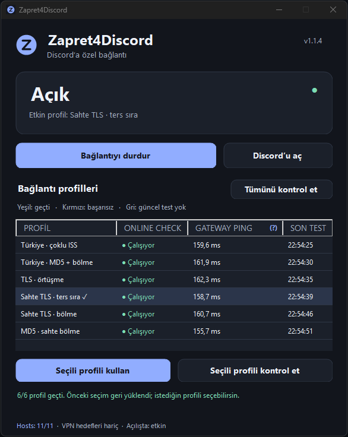

# Zapret4Discord

**Discord'a özel erişim profillerini yöneten, Türkçe arayüzlü küçük bir Windows uygulaması.**

Kurulum dosyası, sistem tepsisi kontrolleri, altı bağlantı profili, gerçek erişim testleri ve Gateway Ping ölçümü bir aradadır. Trafik kapsamı Discord hizmetleriyle sınırlandırılır; tespit edilen FortiClient VPN hedefleri ve sanal ağ bağdaştırıcıları kapsam dışında tutulur.

**[Son sürümü indir](https://github.com/QUINRY/Zapret4Discord/releases/latest)** · [Tüm sürümler](https://github.com/QUINRY/Zapret4Discord/releases) · [Kullanım kılavuzu](docs/KULLANIM.txt)



## Genel özellikler

- **Türkçe arayüz ve kurulum:** Başlat menüsü kısayolu, isteğe bağlı masaüstü kısayolu ve Windows uygulama listesinden kaldırma.
- **Sistem tepsisi:** Çarpıya basınca pencere gizlenir. Sağ tık menüsünden pencereyi açabilir, bağlantıyı başlatabilir/durdurabilir ve arayüzden çıkabilirsin.
- **Altı seçilebilir profil:** Türkiye · çoklu ISS, Türkiye · MD5 + bölme, TLS · örtüşme, Sahte TLS · ters sıra, Sahte TLS · bölme ve MD5 · sahte bölme.
- **Gerçek online check:** Discord API, CDN, HTTPS ağ geçidi, TLS 1.2 güncelleme/API bağlantıları ve anonim WebSocket bağlantısı kontrol edilir.
- **Gateway Ping:** Her profil altında üç ölçüm alınır; ortanca gidiş-dönüş süresi ms cinsinden gösterilir.
- **Açıklamalı yardım:** `GATEWAY PING` yanındaki **(?)** üzerine gelince ses kanalı pinginden farkını anlatan açıklama açılır.
- **Hosts yönetimi:** Gerekli 11 Discord eşlemesi doğrulanır. Hosts göstergesine tıklayarak listeyi ve açıklamasını görebilirsin.
- **Otomatik servis başlatma:** Bağlantı etkin bırakıldıysa Windows açılışında servis hazırlanır. Hedefler ve VPN istisnaları beş dakikada bir yenilenir.

## Sistem gereksinimleri

| Gereksinim | Desteklenen |
|---|---|
| İşletim sistemi | Windows 10 sürüm 2004 ve sonrası / Windows 11 |
| Mimari | Intel veya AMD x64 |
| Çalışma ortamı | .NET Framework 4.8 veya uyumlu daha yeni sürümü |
| Yetki | Kurulum, servis ve hosts işlemleri için yönetici yetkisi |

Kurulum paketini kullanmak için Python veya .NET 8 SDK kurulması gerekmez. ARM64 ve 32 bit Windows için paket yayımlanmıyor.

## Kurulum ve ilk kullanım

1. [Son sürüm sayfasından](https://github.com/QUINRY/Zapret4Discord/releases/latest) `Zapret4Discord-Setup-1.1.4-x64.exe` dosyasını indir.
2. Kurulum dosyasını çalıştır ve Windows yönetici onayını ver.
3. Başlat menüsünden **Zapret4Discord**'u aç. Servis kapalıysa **Discord erişimini aç** düğmesini kullan.
4. **Tümünü kontrol et** ile profilleri kendi bağlantında dene.
5. İstediğin çalışan profili seçip **Seçili profili kullan** düğmesine bas.

Güncelleme, mevcut profili ve etkinlik ayarını korur. Yeni kurulum Türkiye profiliyle hazırlanır. Ağ henüz hazır değilse hazırlama işlemi ağ kullanılabilir olduğunda tekrar denenir.

Kurulum dosyası dijital olarak imzalı değildir. İndirilen dosyanın SHA256 özetini aynı sürümdeki `SHA256SUMS.txt` ile karşılaştırabilirsin:

```powershell
Get-FileHash .\Zapret4Discord-Setup-1.1.4-x64.exe -Algorithm SHA256
```

## Kontrollerin anlamı

| Kontrol / düğme | Davranış |
|---|---|
| Discord erişimini aç / Başlat | Servisi başlatır ve Windows açılışında etkinleştirir. |
| Bağlantıyı durdur / Durdur | Servisi durdurur; yeniden başlatılana kadar otomatik açılmaz. |
| Çarpı veya küçültme | Pencereyi sistem tepsisine gizler. |
| Tepsi simgesine çift tıklama | Pencereyi geri açar. |
| Çıkış | Arayüzü kapatır; çalışan servis devam eder. Erişimi de kapatmak için önce **Durdur**'u kullan. |
| Seçili profili kullan | Profili kaydeder ve etkinleştirir. |
| Seçili profili kontrol et | Yalnızca seçilen profili geçici olarak dener. |
| Tümünü kontrol et | Altı profili sırayla dener. |
| Kurulumu onar | Program bileşenlerini ve servis hazırlığını yeniler. |

Test sırasında Discord bağlantısı kısa süreli kesilebilir. Test tamamlandığında veya iptal edildiğinde önceki profil ve servisin açık/kapalı hali geri yüklenir. Test, farklı bir profili kendiliğinden kalıcı olarak seçmez. Çarpıya basmak testi durdurmaz; tepside devam eder.

## Online check renkleri

| Renk | Anlamı |
|---|---|
| **Yeşil** | O profil altında altı erişim kontrolünün tamamı geçti. |
| **Kırmızı** | En az bir kontrol başarısız oldu. Hata ayrıntısı için hücrenin üzerine gelebilirsin. |
| **Gri** | Güncel ölçüm yok; sonuç eskidi, test yarıda kaldı veya ağ değişti. |

Sonuçlar aynı ağ ve profil kataloğunda **15 dakika** geçerlidir. Son test sütunu yerel saati gösterir. Bir profilin bir bağlantıda çalışması, başka bir ISS veya konumda da çalışacağını garanti etmez. Bu kontroller, gerçek sesli görüşmeyi veya kimlik doğrulamalı VPN oturumunu sınamaz.

## Gateway Ping ile ses kanalı pingi farklıdır

**GATEWAY PING**, Discord'un mesajlaşma ve bağlantı yönetimi için kullandığı ağ geçidine yapılan WebSocket ölçümüdür. Açılmış bağlantıda üç heartbeat yanıtının süresi ölçülür; ortanca değer gösterilir. Ölçüm alınamazsa veya sonuç güncel değilse `—` görünür.

Ses kanalı ayrı bir ses sunucusuna bağlanır ve ses verisini UDP üzerinden taşır. Sunucu, bölge ve ağ yolu farklı olabildiğinden iki değer doğrudan karşılaştırılmaz.

Örneğin uygulamada **154 ms**, Discord ses kanalında **49 ms** görmen normaldir. Bu fark, sesinin 154 ms geciktiğini veya seçtiğin profilin ses gecikmesini artırdığını tek başına göstermez. Sesli görüşme gecikmesini değerlendirirken Discord'un ses bağlantısında gösterdiği değeri esas al.

Bu açıklama uygulamadaki **(?)** yardımında da bulunur. Toplam test süresi, Gateway Ping değerinden ayrıdır.

## Discord kapsamı ve FortiClient

HTTPS müdahalesi fiziksel ağ bağdaştırıcıları, Discord hedef IP'leri ve Discord TLS/SNI alan adlarıyla sınırlandırılır. Paylaşılan IP üzerindeki diğer alan adları normal geçirilir. Ses tarafında yalnızca Discord'un belirli IP discovery paketleri için dar bir kural kullanılır.

- Tespit edilen FortiClient VPN hedefleri ayrıca hariç tutulur.
- Fortinet, Tailscale ve diğer sanal ağ bağdaştırıcıları kapsama alınmaz.
- Genel STUN, QUIC, UDP/443 veya oyun trafiği için kural eklenmez.
- DNS sunucuları, sistem proxy'si, rotalar ve güvenlik ayarları değiştirilmez.

**Filtre işlem adına göre çalışmaz.** Discord'un masaüstü uygulaması kadar tarayıcıdan kullanılan Discord da kapsama girer. Kurumsal VPN yapılandırmaları farklı olabileceğinden FortiClient oturumunu kendi ağında ayrıca doğrulamalısın; her VPN kurulumuyla uyumluluk garantisi verilmez.

## Hosts dosyası hakkında

Program aşağıdaki Discord adlarını belirtilen IP adresleriyle eşler. Kurulumda, başlatırken ve etkin servisin periyodik yenilemesinde kayıtlar doğrulanır:

```text
162.159.128.233 www.discord.com
162.159.128.233 status.discord.com
162.159.128.233 discord.com
162.159.128.233 updates.discord.com
162.159.135.234 discord.gg
162.159.135.234 gateway.discord.gg
162.159.129.233 cdn.discordapp.com
162.159.129.233 discordapp.com
162.159.128.235 latency.discord.media
162.159.128.235 discord.media
104.17.117.93 discord.co
```

Zaten doğru olan kayıtlar korunur. Eksikler programa ait işaretli bloğa eklenir. İlk gerçek değişiklikten önce yedek alınır; çakışan Discord adları düzenlenirken diğer adlar ve yorumlar korunur. Eşlemeler [discord-hosts.txt](app/discord-hosts.txt) dosyasında tanımlıdır.

Hosts göstergesi, yönetilen bu listenin önizlemesini açar. Kaldırma sırasında programın yaptığı hosts değişiklikleri geri alınır; önceden doğru olan kullanıcı kayıtları ve sonradan yapılmış diğer düzenlemeler korunur.

## Veriler, servis ve kaldırma

Profil testleri hesap girişi istemez; Discord tokeni veya sohbet mesajı kullanmaz. Günlükler ve ağ kapsamı bilgileri yerel olarak tutulur.

| Bileşen | Konum / ad |
|---|---|
| Uygulama | `C:\Program Files\Zapret4Discord` |
| Servis | `ZapretDiscordOnly` |
| Açılış ve yenileme görevi | `ZapretDiscordOnly-Refresh` |
| Ayarlar, yedek ve günlükler | `C:\ProgramData\ZapretDiscordOnly` |

**Windows Ayarlar → Uygulamalar → Yüklü uygulamalar → Zapret4Discord → Kaldır** yolunu kullanabilirsin. Program kendi servisini ve görevini kaldırır. İnceleme için günlükler ve yedek kalabilir. Başka uygulamaların kullanabileceği ortak WinDivert sürücüsü topluca silinmez.

Destek için [Issues](https://github.com/QUINRY/Zapret4Discord/issues) bölümüne Windows sürümünü, ISS'ni ve hata metnini yazabilirsin. Günlüklerdeki VPN adresleri ve kişisel bilgileri paylaşmadan önce gizle.

## Kaynak koddan derleme

Uygulama kodu, derleme betikleri ve testler [app](app) klasöründedir. Windows üzerinde **.NET 8 SDK** ve **.NET Framework 4.8** gerekir. Derleme araçları ve sabitlenmiş motor dosyaları ilk çalıştırmada indirilir; dosyalar özetleriyle doğrulanır.

```powershell
Set-Location app
.\Download-Upstream.ps1
.\Build.ps1
```

Kurulum dosyası `app/dist` klasörüne yazılır. Aşağıdaki komutlar da `app` klasöründe çalıştırılır. Kaynak paketi ve SHA256 listesi için:

```powershell
.\scripts\Package-Source.ps1
```

Mevcut kontroller:

```powershell
dotnet build tests/Zapret4Discord.Contracts -c Release
.\tests\Zapret4Discord.Contracts\bin\Release\net48\Zapret4Discord.Contracts.exe
powershell -NoProfile -ExecutionPolicy Bypass -File tests/Test-Hosts.ps1
powershell -NoProfile -ExecutionPolicy Bypass -File tests/Test-Profiles.ps1
```

`Verify-Filter.py`, **kurulu ve kapsamı hazırlanmış** uygulamanın paket filtresini çevrimdışı sınar; ağ paketi göndermez. Bu isteğe bağlı araç için Python gerekir.

Üçüncü taraf bileşenlerin lisans metinleri [licenses](app/licenses) klasöründe, dağıtım bildirimleri [THIRD-PARTY-NOTICES.txt](app/THIRD-PARTY-NOTICES.txt) dosyasındadır. Uygulama Discord veya Fortinet'in resmî ürünü değildir.
